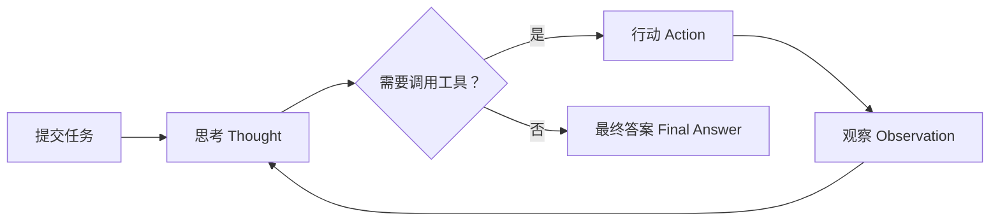
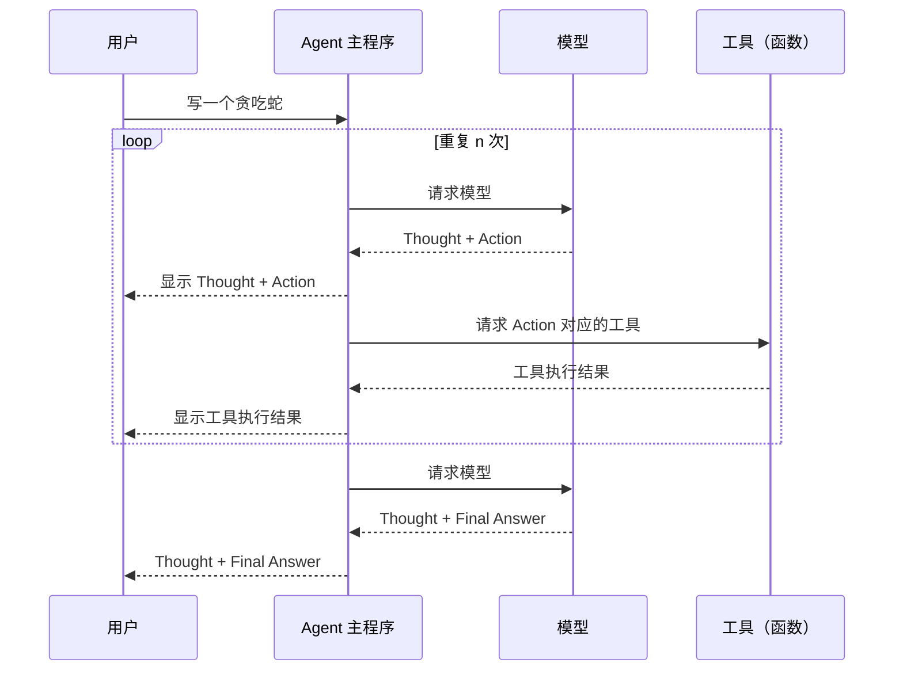
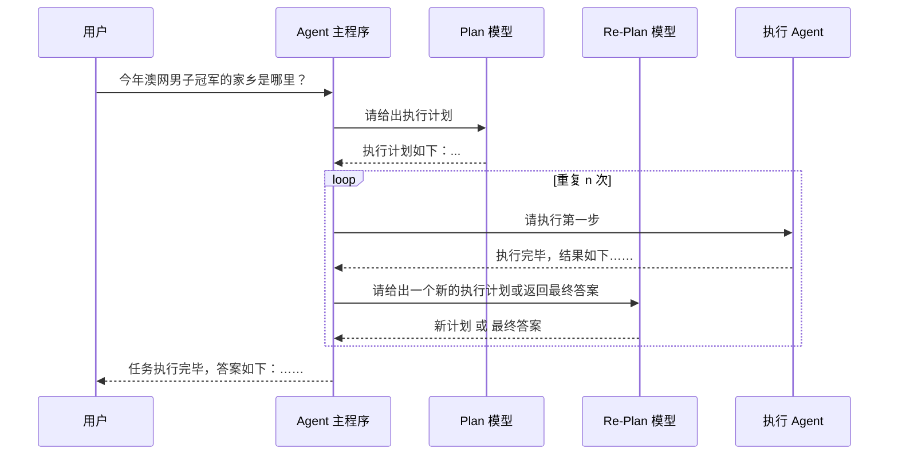

# Agent

> 开发范式需要改变：我们应该把 Agent 当成一个独立的初级程序员，告诉它具体要做的事情和上下文就可以了，具体它的决策和执行过程不需要过于关注，重点把好 Review 这关就行。就像我们学习“递归”算法一样，我们不要去尝试推演整个执行过程。

> 2025.11.9 今天连上 Google Devtools MCP 调试并改进了 aifan.wang 网站性能，确实好用。"Check the performance of https://www.aifan.wang/translate"

大模型无法感知外部世界，也无法影响外部世界，当我们给大模型


## Agent 运行模式

Agent 的概念、原理与构建模式 https://www.youtube.com/watch?v=GE0pFiFJTKo&t=7s

### ReAct 模式

ReAct 模式 Reasoning and Acting：目前使用最为广泛的 Agent 运行模式





ReAct 模式通过 System Prompt 注入大模型。

系统提示词一般包含：「模型角色」「运行规则」「环境信息」等内容


```txt
你需要解决一个问题。为此，你需要将问题分解为多个步骤。对于每个步骤，首先使用 <thought> 思考要做什么，然后使用可用工具之一决定一个 <action>。接着，你将根据你的行动从环境/工具中收到一个 <observation>。持续这个思考和行动的过程，直到你有足够的信息来提供 <final_answer>。

所有步骤请严格使用以下 XML 标签格式输出：
- <question> 用户问题
- <thought> 思考
- <action> 采取的工具操作
- <observation> 工具或环境返回的结果
- <final_answer> 最终答案

⸻

例子 1:

<question>埃菲尔铁塔有多高？</question>
<thought>我需要找到埃菲尔铁塔的高度。可以使用搜索工具。</thought>
<action>get_height("埃菲尔铁塔")</action>
<observation>埃菲尔铁塔的高度约为330米（包含天线）。</observation>
<thought>搜索结果显示了高度。我已经得到答案了。</thought>
<final_answer>埃菲尔铁塔的高度约为330米。</final_answer>

⸻

例子 2:

<question>帮我找一个简单的番茄炒蛋食谱，并看看家里的冰箱里有没有西红柿。</question>
<thought>这个任务分两步。第一步，找到番茄炒蛋的食谱。第二步，检查冰箱里是否有西红柿。我先用 find_recipe 工具找食谱。</thought>
<action>find_recipe(dish="番茄炒蛋")</action>
<observation>简单的番茄炒蛋食谱：将2个鸡蛋打散，2个番茄切块。热油，先炒鸡蛋，盛出。再热油，炒番茄至软烂，加入鸡蛋，放盐调味即可。</observation>
<thought>好的，我已经有食谱了。食谱需要西红柿。现在我需要用 check_fridge 工具看看冰箱里有没有西红柿。</thought>
<action>check_fridge(item="西红柿")</action>
<observation>冰箱检查结果：有3个西红柿。</observation>
<thought>我找到了食谱，并且确认了冰箱里有西红柿。可以回答问题了。</thought>
<final_answer>简单的番茄炒蛋食谱是：鸡蛋打散，番茄切块。先炒鸡蛋，再炒番茄，混合后加盐调味。冰箱里有3个西红柿。</final_answer>

⸻

请严格遵守：
- 你每次回答都必须包括两个标签，第一个是 <thought>，第二个是 <action> 或 <final_answer>
- 输出 <action> 后立即停止生成，等待真实的 <observation>，擅自生成 <observation> 将导致错误
- 如果 <action> 中的某个工具参数有多行的话，请使用 \n 来表示，如：<action>write_to_file("/tmp/test.txt", "a\nb\nc")</action>
- 工具参数中的文件路径请使用绝对路径，不要只给出一个文件名。比如要写 write_to_file("/tmp/test.txt", "内容")，而不是 write_to_file("test.txt", "内容")

⸻

本次任务可用工具：
${tool_list}

⸻

环境信息：

操作系统：${operating_system}
当前目录下文件列表：${file_list}


```

### Plan-and-Execute 模式

https://langchain-ai.github.io/langgraph/tutorials/plan-and-execute/plan-and-execute/




