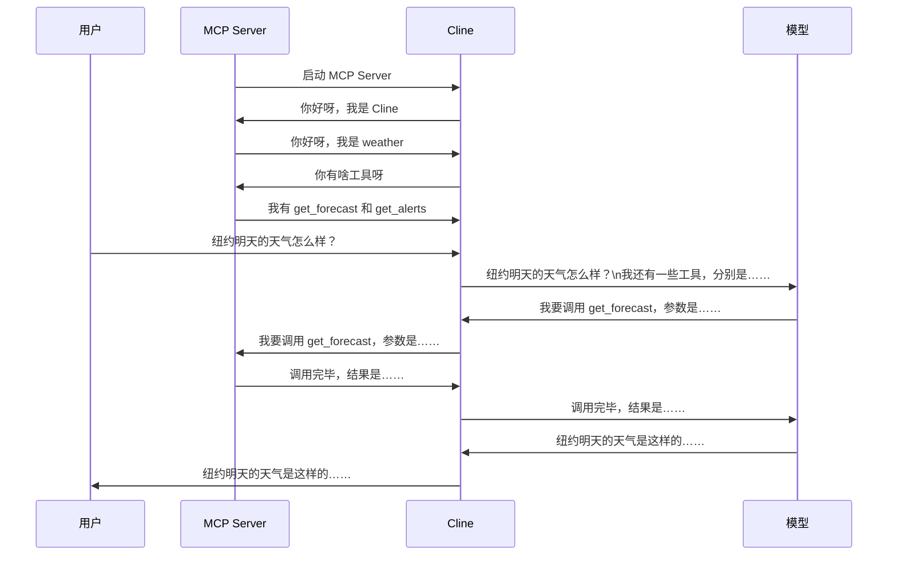
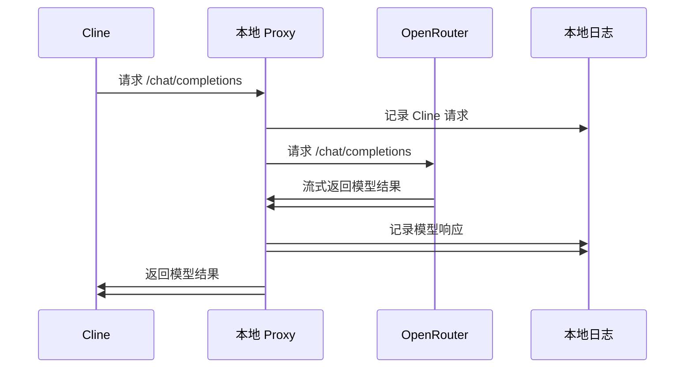

# MCP & A2A


## MCP

* 官网 https://modelcontextprotocol.io/docs/getting-started/intro
* 教程 https://www.youtube.com/watch?v=zrs_HWkZS5w
* 代码见 learn-agent 仓库

MCP 模型上下文协议，即规定 Context 中有哪些 *工具（就是一个函数）、资源* 可以使用。MCP 协议只规定了如何发现和调用函数，其他跟大模型有关的事项都不涉及。

MCP Server 一般都是用 Python 或 Node.js 写的。

MCP 市场
* https://mcp.so


JSON Schema 是一段 JSON，用来描述另外一段 JSON 的结构。

### Cline 中安装 MCP Server

```json
{
  "mcpServer": {
    // 这里填入 MCP Server 信息
    // 这里以 fetch 为示例
    "fetch": {
      "command": "uvx",
      "args": ["mcp-server-fetch"]
    }
  }
}
```

注：因为大多数 MCP Server 是通过 stdio 来通信的，所以加载时不会在控制台随便输出内容

### 时序图




### MCP Host 与 MCP Server 对话抓包

MCP Host (本例中为 Cline) 会启动多个 MCP Server，Host 和各个 Server 之间通过 stdio 传递 JSON 数据包来通信。

```json
// 发送
{
  "method": "initialize",
  "params": {
    "protocolVersion": "2025-03-26",
    "capabilities": {},
    "clientInfo": { "name": "Cline", "version": "3.34.1" }
  },
  "jsonrpc": "2.0",
  "id": 0
}
```

```json
// 接收
{
  "jsonrpc": "2.0",
  "id": 0,
  "result": {
    "protocolVersion": "2025-03-26",
    "capabilities": {
      "experimental": {},
      "prompts": { "listChanged": false },
      "resources": { "subscribe": false, "listChanged": false },
      "tools": { "listChanged": false }
    },
    "serverInfo": { "name": "weather", "version": "1.19.0" }
  }
}
```

```json
// 发送
{ "method": "notifications/initialized", "jsonrpc": "2.0" }
```

```json
// 发送
{ "method": "tools/list", "jsonrpc": "2.0", "id": 1 }
```

```json
// 接收
{
  "jsonrpc": "2.0",
  "id": 1,
  "result": {
    "tools": [
      {
        "name": "get_alerts",
        "description": "Get weather alerts for a US state.\n\nArgs:\n    state: Two-letter US state code (e.g. CA, NY)\n",
        "inputSchema": {
          "properties": { "state": { "title": "State", "type": "string" } },
          "required": ["state"],
          "title": "get_alertsArguments",
          "type": "object"
        },
        "outputSchema": {
          "properties": { "result": { "title": "Result", "type": "string" } },
          "required": ["result"],
          "title": "get_alertsOutput",
          "type": "object"
        }
      },
      {
        "name": "get_forecast",
        "description": "Get weather forecast for a location.\n\nArgs:\n    latitude: Latitude of the location\n    longitude: Longitude of the location\n",
        "inputSchema": {
          "properties": {
            "latitude": { "title": "Latitude", "type": "number" },
            "longitude": { "title": "Longitude", "type": "number" }
          },
          "required": ["latitude", "longitude"],
          "title": "get_forecastArguments",
          "type": "object"
        },
        "outputSchema": {
          "properties": { "result": { "title": "Result", "type": "string" } },
          "required": ["result"],
          "title": "get_forecastOutput",
          "type": "object"
        }
      }
    ]
  }
}
```

```json
// 发送
{ "method": "resources/list", "jsonrpc": "2.0", "id": 2 }
```

```json
// 接收
{ "jsonrpc": "2.0", "id": 2, "result": { "resources": [] } }
```

```json
// 发送
{ "method": "resources/templates/list", "jsonrpc": "2.0", "id": 3 }
```

```json
// 接收
{ "jsonrpc": "2.0", "id": 3, "result": { "resourceTemplates": [] } }
```

```json
// 发送
{
  "method": "tools/call",
  "params": { "name": "get_forecast", "arguments": { "latitude": 40.7128, "longitude": -74.006 } },
  "jsonrpc": "2.0",
  "id": 4
}
```

```json
// 接收
{
  "jsonrpc": "2.0",
  "id": 4,
  "result": {
    "content": [
      {
        "type": "text",
        "text": "\nOvernight:\nTemperature: 53°F\nWind: 18 mph E\nForecast: Rain showers likely. Cloudy. Low around 53, with temperatures rising to around 56 overnight. East wind around 18 mph. Chance of precipitation is 70%. New rainfall amounts less than a tenth of an inch possible.\n\n---\n\nThursday:\nTemperature: 63°F\nWind: 20 to 23 mph E\nForecast: Rain showers before 2pm, then showers and thunderstorms. Cloudy. High near 63, with temperatures falling to around 61 in the afternoon. East wind 20 to 23 mph, with gusts as high as 37 mph. Chance of precipitation is 100%. New rainfall amounts between 1 and 2 inches possible.\n\n---\n\nThursday Night:\nTemperature: 52°F\nWind: 14 to 20 mph S\nForecast: Showers and thunderstorms likely before 2am. Mostly cloudy. Low around 52, with temperatures rising to around 55 overnight. South wind 14 to 20 mph, with gusts as high as 31 mph. Chance of precipitation is 70%. New rainfall amounts between 1 and 2 inches possible.\n\n---\n\nFriday:\nTemperature: 54°F\nWind: 16 to 22 mph SW\nForecast: Partly sunny, with a high near 54. Southwest wind 16 to 22 mph, with gusts as high as 36 mph.\n\n---\n\nFriday Night:\nTemperature: 48°F\nWind: 18 to 23 mph W\nForecast: Partly cloudy. Low around 48, with temperatures rising to around 50 overnight. West wind 18 to 23 mph.\n"
      }
    ],
    "structuredContent": {
      "result": "\nOvernight:\nTemperature: 53°F\nWind: 18 mph E\nForecast: Rain showers likely. Cloudy. Low around 53, with temperatures rising to around 56 overnight. East wind around 18 mph. Chance of precipitation is 70%. New rainfall amounts less than a tenth of an inch possible.\n\n---\n\nThursday:\nTemperature: 63°F\nWind: 20 to 23 mph E\nForecast: Rain showers before 2pm, then showers and thunderstorms. Cloudy. High near 63, with temperatures falling to around 61 in the afternoon. East wind 20 to 23 mph, with gusts as high as 37 mph. Chance of precipitation is 100%. New rainfall amounts between 1 and 2 inches possible.\n\n---\n\nThursday Night:\nTemperature: 52°F\nWind: 14 to 20 mph S\nForecast: Showers and thunderstorms likely before 2am. Mostly cloudy. Low around 52, with temperatures rising to around 55 overnight. South wind 14 to 20 mph, with gusts as high as 31 mph. Chance of precipitation is 70%. New rainfall amounts between 1 and 2 inches possible.\n\n---\n\nFriday:\nTemperature: 54°F\nWind: 16 to 22 mph SW\nForecast: Partly sunny, with a high near 54. Southwest wind 16 to 22 mph, with gusts as high as 36 mph.\n\n---\n\nFriday Night:\nTemperature: 48°F\nWind: 18 to 23 mph W\nForecast: Partly cloudy. Low around 48, with temperatures rising to around 50 overnight. West wind 18 to 23 mph.\n"
    },
    "isError": false
  }
}
```

### 手动与 MCP Server 交互

手动与 MCP Server 交互，即，我们自己充当 MCP Host。

* 手动启动 MCP Server `uv run weather.py`
* 根据 mcp_io.log 内容，手动发送第一条消息（控制台输入消息并回车）`{"method":"initialize","params":{ ...`
* MCP Server 打印第一条回复 `{"jsonrpc":"2.0","id":0,"result":{ ...`
* 继续后续对话 ...

### MCP Host 对 LLM 对话抓包

Cline 通过 XML 与模型沟通

#### 技术实现

Cline 中的 `API Provider` 支持配置 `OpenAI Compatible`，配置对应 Base URL 为我们自己的 *中转服务*地址 http://localhost:8000 就可以了。




## A2A

* 官方文档 https://github.com/a2aproject/A2A
* 教程 https://www.youtube.com/watch?v=75Kz9PoP9aQ

核心概念
* Agent Card - 用于描述 Agent 基本信息的一段 JSON，一般通过 `/.well-known/agent.json` 地址获取
* Message - 用于在 Agent 之间交换信息用的结构体
* Artifact - 被调用的 Agent 的产物，是返回结果里最重要的部分
* Part - 代表 Message 或者 Artifact 里面的一段信息
* Task - 代表被调用 Agent 根据请求所生成的任务

参与者
* 调用方，称为 *A2A Client* 或 *Client Agent*
* 被调用方，称为 *A2A Server* 或 *Remote Agent*

A2A 运行的两个阶段
* Agent 注册阶段
* 用户问答阶段


