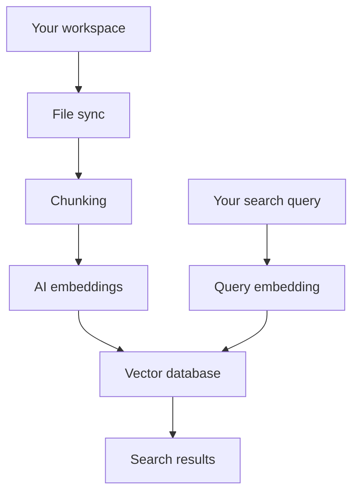

# Cursor


## Quickstart

* Tab `Tab` - Code completion that predicts multi-line edits.
* Inline Edit `Cmd K` - Edit selected code with natural language.
* Agent `Cmd I` - An AI that can read and modify code across multiple files.

## Tab

* `Tab` accept
* `Escape` reject
* `Cmd Right` partial accepts

## Inline Edit

With code selected, `Cmd K` edits that specific code based on your instructions.

Without selection, Cursor generates new code at your cursor position. The AI includes relevant surrounding code for context.

In Cursor terminal, press `Cmd K` to describe your desired action and generates a command.


## Agent

### Chat/Summarizartion

* Message summarization
    - 当对话记录很长时，会将历史对话记录压缩成一条 “Summarized Messages”，当然你可以可以手动输入命令 `/summarize` 进行压缩
* File & folder condensation
    - 只抽取必要的代码，如文件的 Level 1 层级代码，*即单步读取改成多步逐步深入*
    - 大文件可能就留个文件名，或者有些大目录直接就忽略了

### Commands

Custom commands allow you to create reusable workflows that can be triggered with a simple `/` prefix in the chat input box.

Commands are defined as *plan Markdown* files that can be stored in `.cursor/commands` directory.

_create-pr.md_

```md
# Create PR

## Overview
Create a well-structured pull request with proper description, labels, and reviewers.

## Steps
1. **Prepare branch**
   - Ensure all changes are committed
   - Push branch to remote
   - Verify branch is up to date with main

2. **Write PR description**
   - Summarize changes clearly
   - Include context and motivation
   - List any breaking changes
   - Add screenshots if UI changes

3. **Set up PR**
   - Create PR with descriptive title
   - Add appropriate labels
   - Assign reviewers
   - Link related issues

## PR Template
- [ ] Feature A
- [ ] Bug fix B
- [ ] Unit tests pass
- [ ] Manual testing completed
```

### Planning

#### Plan Mode

Plan Mode creates detailed implementation plans writing any code. Cursor also suggests it automatically when you type keywords that indicate complex tasks.

Plans open as ephemeral virtual files that you can view and edit. Click "Save to workspace" to store the plan in `.cursor/plans/` for future reference, team sharing, and documentation.

#### Agent to-dos

#### Queued messages

执行过程中可以继续输入指令...

### Modes

* Agent - Complex features, refactoring
* Ask - Learning, planning, questions
* Plan - Complex features requiring planning
* Custom - Specialized workflows

### Tools

* Search: Read File, List Directory, Codebase, Grep, Search Files, Web, Fetch Rules
* Edit: Edit & Reapply, Delete File
* Run
    * Terminal: Execute terminal commands and monitor output
* MCP: Can use configured MCP servers to interact with external services, such as databases or 3rd party APIs

### Review

When Agent generates code changes, they're presented in a review interface that shows additions and deletions with color-coded lines.

### Terminal

By default, Agent runs terminal commands in a restricted environment that blocks unauthorized file access and network activity. Commands execute automatically while staying confined to your workspace. On macOS, this is implemented using `sandbox-exec`.

### Browser


#### Browser capabilities

Agent has access to the following browser tools:

* Navigate: Agent can visiting URLs, following links, going back and forward in history, and refreshing pages.
* Click: Agent can performing click, double-click, right-click, and hover actions on any visible element.
* Type: Agent can fill out forms, submit data, and interact with form fields, search boxes, and text areas.
* Scroll: 
* Screenshot: Screenshots help Agent understand page layout, verify visual elements, and provide you with confirmation of browser actions.
* Console Output: Read browser console messages, errors, and logs.
* Network Traffic: Agent can track API calls, analyze request payloads, check response status codes, and diagnose network-related issues.


### Security


### Hooks


## Rules

https://cursor.com/docs/context/rules

https://github.com/PatrickJS/awesome-cursorrules/tree/main/rules-new

`.mdc` 文件支持将 rules 拆分到不同子文件，并进行细粒度控制（即，是否添加到 System Prompt）

也支持通过 `AGENTS.md` 简单配置。另外还可以配置支持 `CLAUDE.md` 文件。

```txt
midday/
├── .cursor/
│   └── rules/
│       └── writing-tests.mdc
│
├── apps/
│   ├── api/
│   │   └── .cursor/
│   │       └── rules/
│   │           ├── architecture.mdc
│   │           ├── auth-middleware.mdc
│   │           ├── database-patterns.mdc
│   │           ├── rest-patterns.mdc
│   │           ├── schema-patterns.mdc
│   │           └── trpc-patterns.mdc
│   │
│   ├── dashboard/
│   │   └── .cursor/
│   │       └── rules/
│   │           └── dashboard-patterns.mdc
│   │
│   ├── desktop/
│   │   └── .cursor/
│   │       └── rules/
│   │           └── desktop-patterns.mdc
│   │
│   ├── engine/
│   │   └── .cursor/
│   │       └── rules/
│   │           └── engine-patterns.mdc
│   │
│   ├── website/
│   │   └── .cursor/
│   │       └── rules/
│   │           └── website-patterns.mdc
│   │
│   ├── docs/
│   └── worker/
│
└── packages/
    └── .cursor/
        └── rules/
            └── package-patterns.mdc
```

### Memories

Memories are automatically generated rules based on your conversations in Chat. These memories are scoped to your project and maintain context across sessions.


## Context

### Codebase Indexing (标准的 RAG 系统)

Cursor transforms your code into searchable vectors through a 7-step process:
1. Files are securely synchronized with Cursor's servers 本地代码会上传到服务端
2. Files are broken down into meaningful chunks that capture the essence of your code -- functions, classes, and logical code blocks rather than arbitrary text segments. 语义化分块
3. Each chunks is converted into a vector representation using AI models.
4. These embeddings are stored in a specialized vector database.
5. When you search, your query is converted into a vector using the same AI models that processed your code.
6. The system finds the most similar code chunks by comparing your query's vector against stored embeddings.
7. You get relevant code snippets with file locations and context, ranked by semantic similarity to your search.



## Demo time

### Icon

`Tab`

### express.js project

`Cmd + I`

```txt
setup express.js project with typescript
add a route '/user' to accpet post request to create a new uesr
```

`Cmd + L`

```txt
add a route 'DELETE /user' to delete a user by id
```

### Generate code with Image

### Terminal

```txt
curl to post json object {name: 'gavin'} to 'https://demo.com/users'
```


## GitHub Copilot

- Code Completions (Ghost Text) `Tab` `cmd ->`
- `Cmd + I` Inline Chat
- Chat Sidebar

- `/test` generate tests

## GitHub Copilot vs Cursor

| GitHub Copilot   | Cursor          | Remarks                                                     |
| ---------------- | --------------- | ----------------------------------------------------------- |
| Code Completions | Cursor Tab      | Cursor can predict your next edit, and make smarter changes |
| Inline Chat      | Cursor Composer | Cursor is much powerful with multi-file editing.            |
| Chat Sidebar     | Cursor Chat     |
| Commit Message   | -               |
| Terminal         | Terminal Cmd K  |

## Cursor Tab

https://www.cursor.com/cpp  
https://www.cursor.com/features

- Multi-line completion: Cursor can suggest multiple edits at once, saving your time.
- Predict next edit: Cursor predicts your next cursor position so you can seamlessly navigate your code.

### How to debug Cursor Tab?

> Tab 不工作的时候，可以看看有没有报错，大概率网络问题啥的

In the `OUTPUT` of the Terminal Pannel, choose "Cursor Tab", you should see the error message in the console.


## Cursor Composer

## Cursor Chat

https://www.cursor.com/features

- Codebase Answers: Use `@Codebase` or `⌘ Enter` to ask questions about your codebase. Cursor will search your codebase to find relevant code to your query.
- Ask the web: Get up-to-date information from the internet with `@Web`. Cursor will search the web for you and use the latest information to answer your question.
- Use Documentation: Reference popular libraries using `@LibraryName`, or add your own using `@Docs → Add new doc`.
- Use Images: Hit the image button under chat or drag an image into the input box to include visual context into chat.
- Instant Apply: Apply the code suggestions from chat back into your codebase by clicking the `Apply` button on top of any chat codeblock.

## Settings

### VS Code Settings

### Cursor Settings

- Cursor Tab (GitHub Copilot)
- Composer: Cursor's first multi-file code editing experience
- Chat (GitHub Copilot Chat)

### Proxy

```json
{
    "http.proxy": "http://127.0.0.1:1087",
    "http.proxyStrictSSL": false,
    "cursor.general.disableHttp2": true  // 这个貌似不需要配
}
```


## Temp

`Tab` `cmd + I` Composer `cmd + L` Chat

自然语言编程

比 Copilot 强的地方在于（）

- 能创建文件
- 多文件上下文
- 多文件编辑
